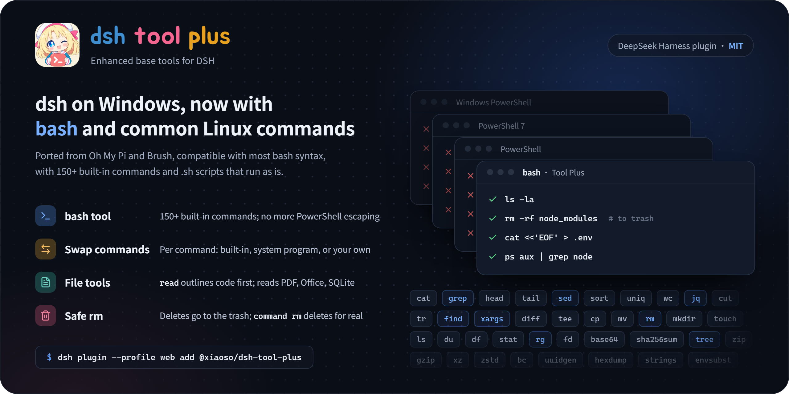

<div align="center">
  <br>
  
</div>

<div align="center">

[简体中文](./README.md) | English

</div>

<div align="center">

[](https://www.npmjs.com/package/@xiaoso/dsh-tool-plus)
[](LICENSE)
[](https://nodejs.org)
[]()

</div>

Essential tools enhancement for DeepSeek Harness: bash takes over the shell work PowerShell used to do, alongside structured read, multi-mode edit, atomic write, full-text search and direct image reading. The core is ported from [Oh My Pi](https://github.com/can1357/oh-my-pi); once installed it takes over the official bash / pwsh / file / search tools.



> ⚠️ **0.3.0 notice**: this release changes the tool surface, default configuration and output shapes fairly aggressively, and includes some experimental features. It differs substantially from 0.2.x — read the [CHANGELOG](CHANGELOG.md) before upgrading.

## Installation

> ⚠️ **Restart dsh after the first install and after every upgrade.**

### Requirements

- **dsh**: `v0.2.2-rc.3` or newer (pre-release; interfaces may change)
- **Node.js** ≥ 24.9
- **Git Bash** (recommended on Windows): bash itself is built into the plugin; Git Bash only adds common Linux tools beyond the built-in commands (such as `awk`)
- **Permissions**: `danger-full-access` is recommended, so sandboxed modes do not block file writes by mistake

### Web

```sh
dsh plugin --profile web add @xiaoso/dsh-tool-plus
```

### Desktop

Install from the app's plugin page by entering the package name `@xiaoso/dsh-tool-plus`.

## Features

### Shell

- **bash**: 150+ commands built in — `ls`, `grep`, `sed`, `jq` and friends work without the system programs of the same name
  - Commands the system often lacks, such as `zip`, `tree`, `bc` and `gzip` / `zstd` / `xz`, ship with the plugin ([details](docs/shell-commands/README.md))
  - The working directory follows `cd` across calls
  - Verbose logs (git/npm/cargo…) are condensed; overlong output keeps only head and tail, with the full content written to disk for later retrieval
  - Long-running commands move to the background
  - Optionally intercepts `cat`, `grep`, `find` and `sed -i` to steer the model toward the dedicated tools (off by default)
- **Safe delete**: `rm` moves files to the system trash by default, so accidental deletes are recoverable; use `command rm` for a real delete

### Files

- **read**: precise line-range reading (`:N-M`, `:raw`, multiple ranges)
  - Large code files return a structural summary by default, with details expanded on demand
  - zip/tar archives, SQLite, notebooks and PDFs read directly
  - PNG / JPEG / WebP / GIF images read directly and scaled down when oversized
  - Fetches web content (including images embedded in the page); SPA sites are fetched through local browser rendering
- **write**: atomic writes that return a diff; supports patch-style writing, and can write directly into archive members and SQLite data
- **edit**: `replace` by default, with patch / hashline / apply-patch formats also supported; uniqueness validation, fuzzy matching tolerant of whitespace differences

### Search

- **grep / glob**: full-text search and filename matching; mtime sorting, context lines and configurable ignore rules
- **ast_grep / ast_edit** (optional): syntax-tree based structural search and rewrite, enabled in settings

### Settings and presets

- **Command panel**: choose, per command, the plugin's built-in, the system program, or an executable of your own
- **agent presets**: Standard enhanced and PTC (Code Mode)

## Usage

### Presets

| Preset | Base | What it is |
|---|---|---|
| **Tool Plus 标准增强版** | official standard | everything in standard mode, with the file/shell toolset swapped for this plugin |
| **Tool Plus PTC 增强版** | official PTC (Code Mode) | same, but composing multi-step operations through Code Mode's `run_code` |

Once the plugin is installed, pick one from the preset list. To adjust them, go to Settings → Tool Plus → Presets: after an official upgrade, click "Follow the official preset"; to go back to the default, click "Revert to bundled".

### Settings

All under Settings → Tool Plus:

- **Command panel** (Bash → Commands): lists every command bash can run and where it comes from; point each one at the plugin's built-in, the system program, or an executable you pick. Changes apply to the next shell
- **Shell init** (Bash → Shell init): a script run each time a shell is created; edit, test-run or reset it

## Performance

A SWE-bench Multilingual comparison (20 tasks × 3 rounds, muse-spark-1.2) of three tool surfaces — official, dsh-ops 0.5.5 and Tool Plus 0.3.0-beta.3 — in both standard and PTC modes. Model, tasks and driver are identical, only the tool surface and call mode change.

| Metric | Official | dsh-ops 0.5.5 | Tool Plus |
|---|---|---|---|
| **Standard mode** | — | — | — |
| Passed | 52/60 | 50/60 | 54/60 |
| Tool error rate | 1.45% | 0.42% | 1.27% |
| Tokens/task | 1,587,695 | 1,604,745 (+1.1%) | **1,291,880 (−18.6%)** |
| Input tokens/task | 57,918 | 56,825 (−1.9%) | **45,218 (−21.9%)** |
| Output tokens/task | 10,758 | 11,793 (+9.6%) | **10,491 (−2.5%)** |
| Cache hit rate | 96.3% | 96.4% | **96.5%** |
| Final context (avg) | 60,634 | 57,829 (−4.6%) | **45,984 (−24.2%)** |
| Final context (max) | 151,784 | 121,073 (−20.2%) | **91,484 (−39.7%)** |
| Tool execution/task | 78 s | 86 s (+10.3%) | **71 s (−9.4%)** |
| Wall clock/task | 199 s | 212 s (+6.6%) | **197 s (−1.0%)** |
| Cost/task | $0.0110 | $0.0111 | **$0.0091** |
| **PTC mode** | — | — | — |
| Passed | 52/60 | 52/60 | 54/60 |
| PTC failure rate | 3.69% | 3.54% | 7.33% |
| Tokens/task | 1,487,869 | **1,303,306 (−12.4%)** | 1,459,520 (−1.9%) |
| Input tokens/task | 66,050 | 62,604 (−5.2%) | **53,886 (−18.4%)** |
| Output tokens/task | 12,248 | **11,889 (−2.9%)** | 12,037 (−1.7%) |
| Cache hit rate | 95.5% | 95.2% | **96.3%** |
| Final context (avg) | 67,719 | 65,531 (−3.2%) | **59,030 (−12.8%)** |
| Final context (max) | 177,232 | 164,354 (−7.3%) | **147,912 (−16.5%)** |
| Tool execution/task | 95 s | 88 s (−6.9%) | **85 s (−10.5%)** |
| Wall clock/task | 218 s | **196 s (−10.0%)** | 213 s (−2.2%) |
| Cost/task | $0.0119 | $0.0111 | **$0.0106** |

Parentheses show the change from the same-mode official baseline; bold marks the better value in each row. The standard-mode tool error rate aggregates the per-tool failures in report §8.3, counting only results whose body starts with `Error:`; dsh-ops' `ops_*` errors bypass that rule, so its figure is understated. The PTC failure rate is the per-`run_code`-call failure rate. Tokens = input + cache read + output; input is the uncached portion and output includes thinking, so cache hit = cache read ÷ (input + cache read). Standard mode cuts tokens 18.6% (input −21.9%, cache reads −18.6%), at the cost of 47% more read calls; PTC is roughly flat on tokens (input −18.4%, cache reads −1.1%), and executes faster but takes more steps and carries higher fixed overhead. The pass-count differences were checked and are random run-to-run noise. Full per-task, per-tool and cost breakdown: [report](docs/benchmark/sbml-compare-3plugins.md) (Chinese).

> Final context is the context size at each session's last step; one Tool Plus standard-mode subagent session is excluded.

> These figures come from 0.3.0-beta.3. The 7.33% PTC failure rate includes 63 errors caused by the missing `description` argument; excluding them it is 4.03%, in line with the baselines. That failure mode does not represent the current defaults.

## Notes

- No standalone `pwsh` tool: shell work is handled by the more capable `bash`
- **bash state**: by default each command gets its own shell and only the working directory follows `cd`; set `autoBackgroundMs` to `0` to share one persistent shell, where exported variables, aliases and shell functions carry over. The change applies immediately — the description the model sees is rewritten with it, no restart.
- Presets showing "failed to load": the plugin is too old (0.1.19 or earlier), upgrade it; if the official presets changed after that, click "Follow the official preset" under Settings → Tool Plus → Presets to rebase them
- Pointed a command at the wrong program in the command panel: change it back there, or delete `$DSH_HOME/tool-plus/commands.json` to return to the defaults

**Safe rm sends deleted files to the system trash.** Where they land, and whether you can see them:

| | Windows | macOS | Linux |
|---|---|---|---|
| **Location** | Recycle Bin | Trash `~/.Trash` | `$XDG_DATA_HOME/Trash`; defaults to `~/.local/share/Trash` |
| **Another volume / external disk** | That volume's Recycle Bin | That volume's `.Trashes` | `.Trash-<uid>` at that mount point |
| **Visible in the OS trash** | Yes | Yes | Same volume: yes; another volume: open that location |
| **File name** | Unchanged | Unchanged | A UUID; the original name comes from `.trashinfo` |
| **Put back** | Yes | Yes | Depends on the file manager |
| **Implementation** | Shell API | System API | Third-party XDG implementation |
| **Known limits** | No Recycle Bin on network drives | Requires macOS 10.12+ | Some desktops do not list it — restore from the location above |

## License

[MIT](LICENSE); third-party component licenses in [THIRD_PARTY_NOTICES.md](THIRD_PARTY_NOTICES.md).
