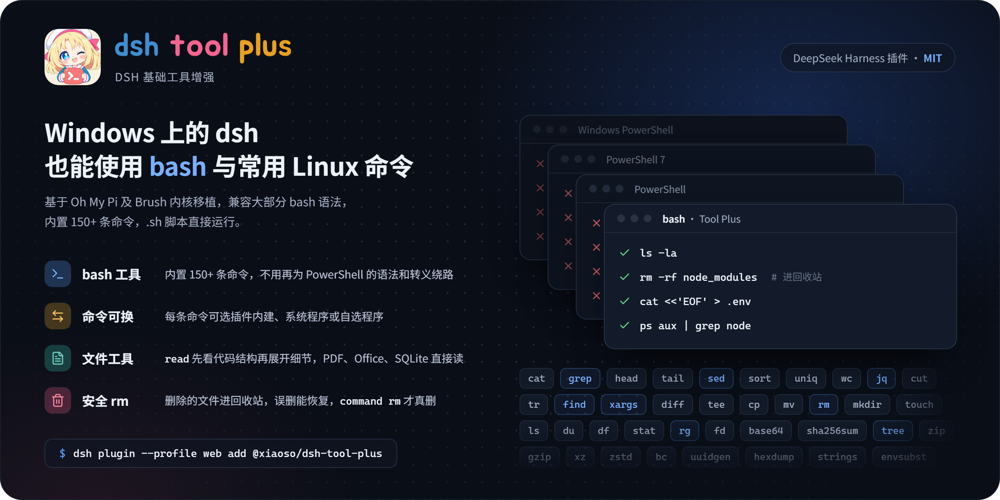

<div align="center">
  <br>
  
</div>

<div align="center">

简体中文 | [English](./README.en.md)

</div>

<div align="center">

[](https://www.npmjs.com/package/@xiaoso/dsh-tool-plus)
[](LICENSE)
[](https://nodejs.org)
[]()

</div>

DeepSeek Harness 基础工具增强：用 bash 取代 PowerShell 承担 shell 场景，并提供结构化 read、多模式 edit、原子 write、全文搜索与图像直读。内核移植自 [Oh My Pi](https://github.com/can1357/oh-my-pi)，安装后自动接管官方的 bash / pwsh / 文件 / 搜索工具。



## 功能特性

### Shell

- **bash**：内置 150+ 条命令，`ls`、`grep`、`sed`、`jq` 等常用工具不依赖系统里的同名程序
  - `zip`、`tree`、`bc`、`gzip` / `zstd` / `xz` 等系统里常缺的命令也由插件自带（[说明](docs/shell-commands/README.md)）
  - 工作目录跟随 `cd` 跨调用保持
  - 冗长日志（git/npm/cargo…）自动压缩；超长输出只留头尾，完整内容落盘可回读
  - 长命令自动转后台
  - 可选拦截 `cat`、`grep`、`find`、`sed -i`，引导模型改用专用工具（默认关闭）
- **安全删除**：`rm` 默认把文件移进系统回收站，误删可恢复；要真删用 `command rm`

### 文件

- **read**：按行区间读（`:N-M`、`:raw`、多区间）
  - 大代码文件默认给结构摘要，细节按需展开
  - zip/tar、SQLite、notebook、PDF 直接读
  - PNG / JPEG / WebP / GIF 图片直读，超大图自动缩放
  - 可抓网页（含页内图片），SPA 站点改用本机浏览器渲染后再抓
- **write**：原子写入并返回 diff；支持补丁式写入，可直接写归档成员与 SQLite 数据
- **edit**：replace 默认，另支持 patch / hashline / apply-patch；多段编辑、唯一性校验、空白模糊匹配

### 搜索

- **grep / glob**：全文搜索与文件名匹配；mtime 排序、上下文行、忽略规则可配置
- **ast_grep / ast_edit**（可选）：基于语法树的结构化搜索与重写，设置里开启

### 设置与预设

- **命令面板**：逐条指定每个命令用插件内建、系统程序，还是你自选的可执行文件
- **agent 预设**：标准增强版 / PTC（Code Mode）两套

## 安装

Web 端：

```sh
dsh plugin --profile web add @xiaoso/dsh-tool-plus
```

桌面端：在插件页输入包名 `@xiaoso/dsh-tool-plus` 安装。

### 环境要求

- **dsh**：`v0.2.2-rc.3` 及以上（pre-release，接口可能变动）
- **Node.js** ≥ 24.9
- **Git Bash**（Windows 推荐）：bash 本身由插件内置，Git Bash 只用来补充内置命令之外的常用 Linux 工具（如 `awk`）
- **权限**：建议在 `danger-full-access` 下使用，避免沙箱模式误拦文件写入

## 使用

### 预设

| 预设 | 底座 | 说明 |
|---|---|---|
| **Tool Plus 标准增强版** | 官方 standard | 官方标准模式全部能力 + 文件/Shell 工具集换成本插件 |
| **Tool Plus PTC 增强版** | 官方 PTC（Code Mode） | 同上，但经 Code Mode 以 `run_code` 组合多步操作 |

装好插件后在预设列表里直接选。需要调整时到 设置 → Tool Plus → 预设：官方升级后点「跟随官方」；想回到默认点「恢复随包」。

### 设置

都在 设置 → Tool Plus 里：

- **命令面板**（Bash → 命令）：列出 bash 里能跑的每条命令及其来源，可逐条改用插件内建、系统程序或自选的可执行文件；改完对新开的 shell 生效
- **Shell 初始化**（Bash → Shell 初始化）：每次创建 shell 时执行的脚本，可编辑、试运行、恢复默认

## 性能

在 Linux 上跑 SWE-bench Multilingual（20 题 × 3 轮），对比官方标准模式与本插件标准增强版。数据来自插件 0.1.13，0.2.x 尚未重测。

| 指标 | 官方工具面 | 本插件（命令拦截开） | 本插件（命令拦截关，默认） |
|---|---|---|---|
| 解题率 | 83.3% | **83.3%** | 81.7%（低 1 题，正常波动） |
| 步数 / 题 | 24.4 | 29.7（+21.7%） | 25.3（+3.8%） |
| 总 token / 题 | **729,434** | 954,100（+30.8%） | 779,799（+6.9%） |
| 系统提示词 / 步（含工具定义） | **4,642** | 6,305（+35.8%） | 6,305（+35.8%） |
| 系统提示词累计 / 题（单步 × 步数） | **113,265** | 187,259（+65.3%） | 159,622（+40.9%） |
| 净 token / 题（除系统提示词） | **616,169** | 766,841（+24.5%） | 620,177（+0.7%） |
| 任务结束后平均上下文长度（token） | **42,817** | 48,645（+13.6%） | 44,781（+4.6%） |
| `read` 调用次数 | 225 | 459 | **198** |
| `bash` 每次调用耗时 | 3,140 ms | **2,391 ms** | 2,045 ms |
| `bash` 每次调用返回 token | 790 tok | **343 tok** | 638 tok |
| 平均耗时 / 题 | **123 s** | 135 s | 151 s |

注：

1. 平均耗时为端到端实测，受 token 速率与网速影响，只作横向参考
2. 该基准任务上下文占用较低，不代表大任务的表现
3. 数据由大模型统计核对，可能有疏漏，但不影响整体结论

结论：

1. 解题率与官方持平（命令拦截关的那组低 1 题，属正常波动）
2. `bash` 本身更省、更快，但省下的 token 基本被更厚的工具定义（功能更多）抵消
3. 在 Linux 上综合性能与官方默认标准模式相当，功能更丰富；Windows 不适合跑标准测试，只能说**个人体感**比 PowerShell 好用

完整数据与逐题矩阵见 [docs/benchmark/sbml-compare-ops.md](docs/benchmark/sbml-compare-ops.md)。

## 注意事项

- 不提供单独的 `pwsh` 工具：shell 场景由功能更全的 `bash` 统一承担
- **bash 的状态保持**：默认每条命令单独开 Shell，只有工作目录跟随 `cd`；把 `autoBackgroundMs` 设为 `0` 后共用一个持久 Shell，`export` 的变量、别名与函数都跨调用保留。改完立即生效，工具给模型的说明会同步改写，不用重启
- 预设显示「加载失败」：插件版本太旧（0.1.19 及以前），升级即可；升级后官方又改过预设的话，在 设置 → Tool Plus → 预设 点「跟随官方」重派生一次
- 命令面板里把某条命令指错了：在同一处改回来，或删掉 `$DSH_HOME/tool-plus/commands.json` 回到默认

**安全 rm 删掉的文件进系统回收站**，各平台的落点与可见性：

| | Windows | macOS | Linux |
|---|---|---|---|
| **落点** | 回收站 | 废纸篓 `~/.Trash` | `$XDG_DATA_HOME/Trash`；默认 `~/.local/share/Trash` |
| **跨卷 / 外接盘** | 该卷回收站 | 该卷 `.Trashes` | 该挂载点 `.Trash-<uid>` |
| **系统回收站可见** | 可见 | 可见 | 同卷可见；跨卷要打开该位置 |
| **文件名** | 原名 | 原名 | UUID，靠 `.trashinfo` 还原 |
| **放回原处** | 支持 | 支持 | 视文件管理器 |
| **实现** | Shell API | 系统 API | 第三方 XDG 实现 |
| **已知限制** | 网络盘无回收站 | 需 10.12+ | 部分桌面环境看不到，需到落点自行还原 |

## License

[MIT](LICENSE)，第三方组件许可见 [THIRD_PARTY_NOTICES.md](THIRD_PARTY_NOTICES.md)。
