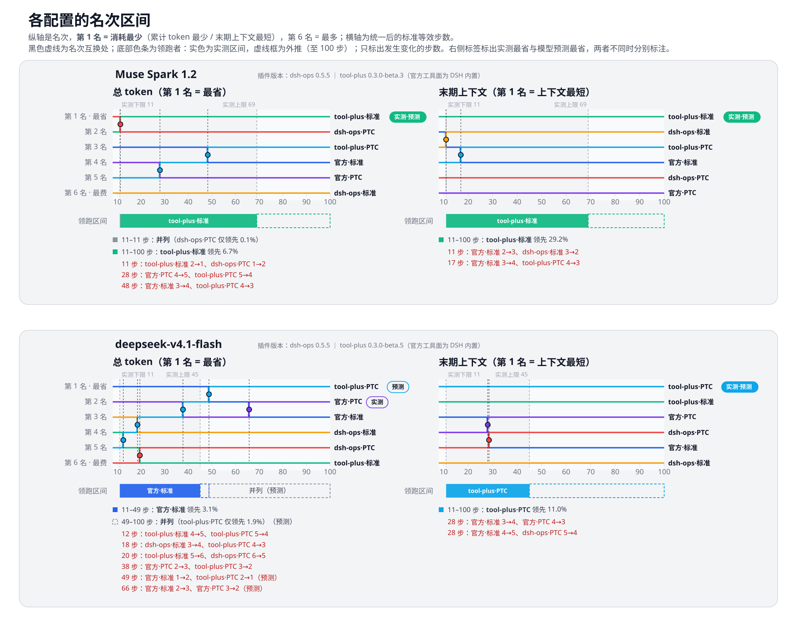

# Performance and comparison

[← Back to README](../../README.en.md)

Two independent experiments. Tool counts and plugin versions differ, so **do not compare across models**; each table is a within-group comparison only.

Parentheses are changes vs. the official baseline; bold marks the better token, context or time value, while steps, pass counts and failure rates are shown but not bolded. Tokens = input + cache read + output; final context is the last-step context. Pass-count differences are random noise.

## Muse Spark 1.2

20 tasks × 3 rounds; tool surfaces 23 / 24 / 22 (official / dsh-ops / Tool Plus); the standard Tool Plus group includes one subagent session.

| Metric | Official | dsh-ops 0.5.5 | Tool Plus 0.3.0-beta.3 |
|---|---|---|---|
| **Standard mode** | — | — | — |
| Passed | 52/60 | 50/60 | 54/60 |
| Tool error rate | 1.45% | 0.42%* | 1.27% |
| Tokens/task | 1,587,695 | 1,604,745 (+1.1%) | **1,291,880 (−18.6%)** |
| Final context (avg / max) | 60,634 / 151,784 | 57,829 (−4.6%) / 121,073 (−20.2%) | **45,984 (−24.2%) / 91,484 (−39.7%)** |
| Steps/task | 32.1 | 36.4 (+13.6%) | 35.7 (+11.4%) |
| Wall clock/task | 199 s | 212 s (+6.6%) | **197 s (−1.0%)** |
| **PTC mode** | — | — | — |
| Passed | 52/60 | 52/60 | 54/60 |
| PTC failure rate | 3.69% | 3.54% | 7.33% |
| Tokens/task | 1,487,869 | **1,303,306 (−12.4%)** | 1,459,520 (−1.9%) |
| Final context (avg / max) | 67,719 / 177,232 | 65,531 (−3.2%) / 164,354 (−7.3%) | **59,030 (−12.8%) / 147,912 (−16.5%)** |
| Steps/task | 27.9 | 25.9 (−7.2%) | 32.7 (+17.1%) |
| Wall clock/task | 218 s | **196 s (−10.0%)** | 213 s (−2.2%) |

Tool Plus cuts standard-mode tokens 18.6% while PTC is roughly flat (−1.9%); final context is lower in both modes. Full token breakdown, cache hit rate, cost and per-tool data are in the [report](sbml-compare-3plugins.md) (Chinese).

> `*` The dsh-ops standard tool error rate counts only tool results starting with `Error:`; `ops_*` errors are excluded. The PTC 7.33% becomes 4.03% after excluding 63 missing top-level `description` errors; that failure mode does not represent the current defaults. The standard group includes one subagent session: its tokens, steps and tool calls are counted, final context is not.

## DeepSeek V4.1 Flash

20 tasks × 3 rounds; tool surfaces 18 / 19 / 17 (official / dsh-ops / Tool Plus); subagent and messaging tools are disabled in all six groups, and there are no sub-sessions.

| Metric | Official | dsh-ops 0.5.5 | Tool Plus 0.3.0-beta.5 |
|---|---|---|---|
| **Standard mode** | — | — | — |
| Passed | 60/60 | 59/60 | 59/60 |
| Tool error rate | 0.99% | 3.78%* | 1.84% |
| Tokens/task | **688,014** | 776,396 (+12.8%†) | 702,446 (+2.1%) |
| Final context (avg / max) | 43,429 / 103,486 | 45,653 (+5.1%) / 119,509 (+15.5%) | **40,246 (−7.3%) / 96,143 (−7.1%)** |
| Steps/task | 22.6 | 23.6 (+4.4%) | 26.0 (+15.0%) |
| Wall clock/task | 156 s | **148 s (−4.9%)** | 159 s (+2.2%) |
| **PTC mode** | — | — | — |
| Passed | 59/60 | 59/60 | 60/60 |
| PTC failure rate | 2.21% | 2.38% | 2.71% |
| Tokens/task | **666,099** | 725,926 (+9.0%) | 692,881 (+4.0%) |
| Final context (avg / max) | 42,387 / 86,075 | 42,310 (−0.2%) / **85,001 (−1.2%)** | **37,379 (−11.8%)** / 88,367 (+2.7%) |
| Steps/task | 23.4 | 24.6 (+5.1%) | 26.7 (+14.0%) |
| Wall clock/task | **147 s** | 173 s (+17.5%) | 153 s (+4.5%) |

Tool Plus tokens are slightly above official in both modes (+2.1% / +4.0%); standard steps are 15.0% higher, while PTC wall clock is 4.5% higher. Full token breakdown, cache hit rate and per-tool data are in the [report](sbml-compare-3plugins-deepseek-v4.1-flash.md) (Chinese).

> `*` The dsh-ops standard tool error rate counts only tool results starting with `Error:`; `ops_*` errors are excluded. `†` The dsh-ops standard mean includes one 90-step, 7.22M-token outlier; excluding it gives 667k, with a 671k median (official 688k).

## Scale extrapolation (forecast)

> ⚠️ **This chart is a model forecast, not the measured results above.** Solid lines stop at the measured step limit; dashed lines extrapolate to 100 steps. The rank axis mixes standard and PTC, so it shows each metric's order only and is not a per-mode decision ranking; leads below 2% count as a tie. The fit drops one outlier session, so the ranks and lead margins come from the filtered fit and are not on the same basis as the raw means above; the two configurations differ, so do not compare across models.

<picture>
  <source media="(prefers-color-scheme: dark)" srcset="rank-bands-dark.svg">
  
</picture>

*Source: context-model v9 (2026-11-25); chart labels in Chinese; [full-size SVG](rank-bands.svg).*
