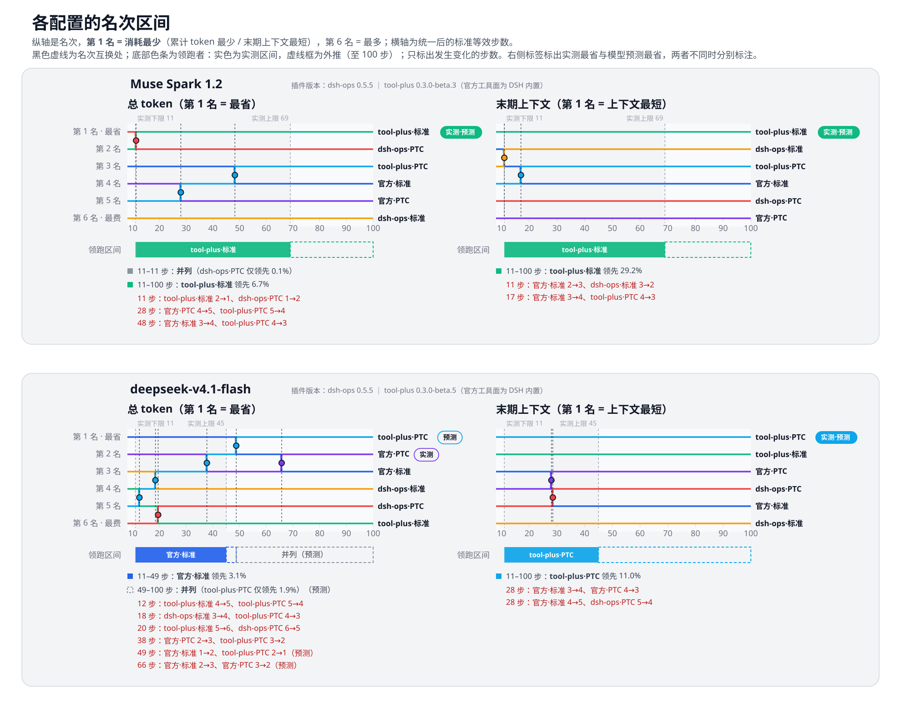

# 性能与对比

[← 返回 README](../../README.md)

两组独立实验，工具面数量与插件版本不同，**不能跨模型比较**；每张表只做组内对比。

括号为相对官方基线的变化，加粗为 token、上下文与耗时中的较优值；步数、通过数与失败率仅列数值，不加粗。token = 输入 + 缓存读 + 输出，结束上下文取会话最后一步；通过数差异属随机波动。

## Muse Spark 1.2

20 题 × 3 轮；工具面 23 / 24 / 22（官方 / dsh-ops / Tool Plus）；标准组含 1 条子代理会话。

| 指标 | 官方 | dsh-ops 0.5.5 | Tool Plus 0.3.0-beta.3 |
|---|---|---|---|
| **标准模式** | — | — | — |
| 通过数 | 52/60 | 50/60 | 54/60 |
| 工具报错率 | 1.45% | 0.42%* | 1.27% |
| token/题 | 1,587,695 | 1,604,745（+1.1%） | **1,291,880（−18.6%）** |
| 结束上下文（平均 / 最大） | 60,634 / 151,784 | 57,829（−4.6%）/ 121,073（−20.2%） | **45,984（−24.2%）/ 91,484（−39.7%）** |
| 步数/题 | 32.1 | 36.4（+13.6%） | 35.7（+11.4%） |
| 墙钟/题 | 199 s | 212 s（+6.6%） | **197 s（−1.0%）** |
| **PTC 模式** | — | — | — |
| 通过数 | 52/60 | 52/60 | 54/60 |
| PTC 失败率 | 3.69% | 3.54% | 7.33% |
| token/题 | 1,487,869 | **1,303,306（−12.4%）** | 1,459,520（−1.9%） |
| 结束上下文（平均 / 最大） | 67,719 / 177,232 | 65,531（−3.2%）/ 164,354（−7.3%） | **59,030（−12.8%）/ 147,912（−16.5%）** |
| 步数/题 | 27.9 | 25.9（−7.2%） | 32.7（+17.1%） |
| 墙钟/题 | 218 s | **196 s（−10.0%）** | 213 s（−2.2%） |

Tool Plus 的标准模式 token 降 18.6%，PTC 基本持平（−1.9%）；两种模式的结束上下文都更低。完整 token 拆分、缓存命中率、花费与逐工具数据见[报告](sbml-compare-3plugins.md)。

> `*` dsh-ops 标准工具报错率只统计正文以 `Error:` 开头的工具结果，`ops_*` 错误不计入。PTC 7.33% 扣除 63 次缺少顶层 `description` 的参数错误后为 4.03%，该失败模式不代表当前默认配置；标准组含 1 条子代理会话，其 token、步数与工具调用计入，结束上下文不计。

## DeepSeek V4.1 Flash

20 题 × 3 轮；工具面 18 / 19 / 17（官方 / dsh-ops / Tool Plus）；六组均关闭子代理与消息工具，无子会话。

| 指标 | 官方 | dsh-ops 0.5.5 | Tool Plus 0.3.0-beta.5 |
|---|---|---|---|
| **标准模式** | — | — | — |
| 通过数 | 60/60 | 59/60 | 59/60 |
| 工具报错率 | 0.99% | 3.78%* | 1.84% |
| token/题 | **688,014** | 776,396（+12.8%†） | 702,446（+2.1%） |
| 结束上下文（平均 / 最大） | 43,429 / 103,486 | 45,653（+5.1%）/ 119,509（+15.5%） | **40,246（−7.3%）/ 96,143（−7.1%）** |
| 步数/题 | 22.6 | 23.6（+4.4%） | 26.0（+15.0%） |
| 墙钟/题 | 156 s | **148 s（−4.9%）** | 159 s（+2.2%） |
| **PTC 模式** | — | — | — |
| 通过数 | 59/60 | 59/60 | 60/60 |
| PTC 失败率 | 2.21% | 2.38% | 2.71% |
| token/题 | **666,099** | 725,926（+9.0%） | 692,881（+4.0%） |
| 结束上下文（平均 / 最大） | 42,387 / 86,075 | 42,310（−0.2%）/ **85,001（−1.2%）** | **37,379（−11.8%）**/ 88,367（+2.7%） |
| 步数/题 | 23.4 | 24.6（+5.1%） | 26.7（+14.0%） |
| 墙钟/题 | **147 s** | 173 s（+17.5%） | 153 s（+4.5%） |

Tool Plus 两种模式的 token 都略高于官方（+2.1% / +4.0%）；标准模式步数 +15.0%，PTC 墙钟 +4.5%。完整 token 拆分、缓存命中率与逐工具数据见[报告](sbml-compare-3plugins-deepseek-v4.1-flash.md)。

> `*` dsh-ops 标准工具报错率只统计正文以 `Error:` 开头的工具结果，`ops_*` 错误不计入。`†` dsh-ops 标准组均值含一个 90 步、7.22M token 的异常会话；剔除后为 667k，中位数 671k（官方 688k）。

## 规模外推（预测）

> ⚠️ **这张图是模型预测，不是上表的实测成绩。** 实线只画到实测步数上限，虚线是到 100 步的外推；名次把标准与 PTC 放在同一纵轴，只表示该指标的名次，不能替代按模式分开的决策；领先不足 2% 视为并列。模型拟合剔除了 1 个异常会话，图里的名次与领先幅度按剔除后的拟合值计算，和上表原始均值不是同一口径；两组配置不同，也不能跨模型比较。

<picture>
  <source media="(prefers-color-scheme: dark)" srcset="rank-bands-dark.svg">
  
</picture>

*图源：context-model v9（2026-11-25）；[原图](rank-bands.svg)。*
